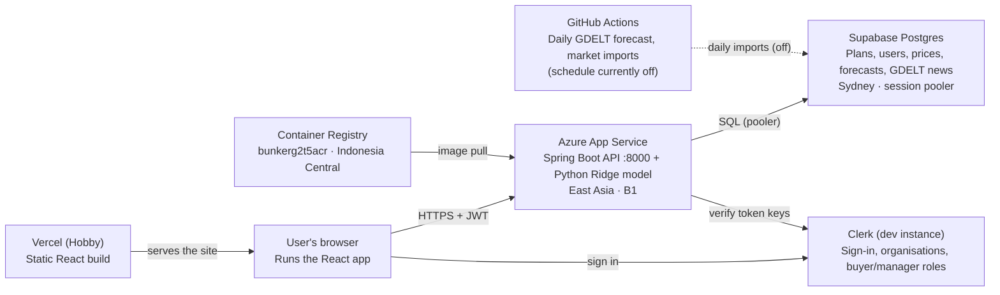

# Bunker Buddy Infrastructure Guide

As of 30 Oct 2026. Living copy: [Bunker Buddy Infrastructure Guide](https://claude.ai/artifact/VwiVmtawEYNxNDSXmj4Pe9).

## Overview

Bunker Buddy is publicly deployed: the React frontend runs on Vercel and calls the Spring Boot API on Azure App Service, which reads and writes the Supabase PostgreSQL database and verifies Clerk sign-ins. This meets the brief's requirement for a public backend deployment on a cloud platform, with Swagger docs.



Only the App Service talks to the database; the browser holds a Clerk token that the API verifies on every protected request.

| What | URL |
| --- | --- |
| Frontend (live app) | [bunker-buddy-nine.vercel.app](https://bunker-buddy-nine.vercel.app) |
| Backend API | [bunker-buddy-api.azurewebsites.net](https://bunker-buddy-api.azurewebsites.net) |
| Swagger UI (for demos) | [bunker-buddy-api.azurewebsites.net/docs](https://bunker-buddy-api.azurewebsites.net/docs) |
| Health check | [bunker-buddy-api.azurewebsites.net/health](https://bunker-buddy-api.azurewebsites.net/health) |
| Azure portal | [portal.azure.com](https://portal.azure.com) → resource group `bunker-rg` |
| Vercel dashboard | [vercel.com/woshiniaoshen/bunker-buddy](https://vercel.com/woshiniaoshen/bunker-buddy) |

Verified on 30 Oct 2026: sign-in, home, purchase plans, recommendation and market dashboard all load real data on the live URLs with no console errors. Forecasts still show as unavailable because the daily GDELT workflow is switched off.

## Resources and costs

Everything runs on free tiers except Azure, which costs about USD 18 a month from the USD 100 Azure for Students credit (subscription on nelson.tan.2025@computing.smu.edu.sg).

| Resource | Name | Where | Plan | Cost / month |
| --- | --- | --- | --- | --- |
| Azure resource group | `bunker-rg` | Indonesia Central (Jakarta) | — | Free |
| Azure Container Registry | `bunkerg2t5acr` (`bunkerg2t5acr.azurecr.io`) | Indonesia Central (Jakarta) | Basic | ~USD 5 |
| Azure App Service plan | `bunker-plan` | East Asia (Hong Kong) | B1 Linux: 1 vCPU, 1.75 GB | ~USD 13 |
| Azure web app | `bunker-buddy-api` | East Asia (Hong Kong) | Runs on `bunker-plan` | Included |
| Vercel project | `bunker-buddy` (account `woshiniaoshen`) | Global edge | Hobby | Free |
| Database | Supabase PostgreSQL (session pooler) | Sydney (`ap-southeast-2`) | Free | Free |
| Auth | Clerk development instance | Clerk cloud | Free | Free |
| Scheduled jobs | GitHub Actions on `raetan2023/cs203-g2t5` | GitHub | Free | Free |

Why these choices:

- **Azure App Service, not a free host:** Spring Boot starts Python (pandas, scikit-learn) as a subprocess, so one container needs Java 21 and Python, about 520–640 MB of memory. Free 512 MB tiers would run out of memory and sleep between requests.
- **Regions:** SMU's policy allows only East Asia, Indonesia Central, Japan East, India South Central and UAE North. Singapore is not allowed.
- **Jakarta registry, Hong Kong app:** Jakarta is closest to the Sydney database, but it had no spare App Service capacity on 30 Oct, so the app runs in Hong Kong and pulls its image from Jakarta.
- **Vercel for the frontend:** free, builds Vite apps directly, and serves the static site from a global CDN.

## Container image

The backend ships as one Docker image, built from the `Dockerfile` at the `cs203-g2t5` repo root. It contains the Spring Boot jar, a Python 3.12 environment and the Ridge model. The root is used because the image needs both `backend/` and `ridge-regression-model/`.

| Stage | Base image | What it does | Kept in final image |
| --- | --- | --- | --- |
| 1. Build | `eclipse-temurin:21-jdk-noble`, built natively on your machine's CPU | Copies `backend/` and runs `./mvnw -DskipTests package` | Only the jar |
| 2. Runtime | `eclipse-temurin:21-jre-noble` (Ubuntu 24.04) | Installs Python 3.12, creates `/app/.venv` from `requirements-lock.txt`, copies `ridge-regression-model/` and the jar | Yes |

Layout inside the image:

```
/app/.venv/                    Python environment
/app/ridge-regression-model/   model code, artifacts, series dictionary
/app/backend/app.jar           Spring Boot API (working directory)
```

- This layout matches `RidgeInference`'s defaults (`../ridge-regression-model` and `../.venv/bin/python`), so no `MGO_RIDGE_*` settings are needed.
- The container runs `java -XX:MaxRAMPercentage=60 -jar app.jar` on port 8000. Java sends database rows to `python -m src.purchase_inference` on standard input and reads the forecast back, with a 25-second timeout.
- `.dockerignore` keeps `.env` files, `node_modules`, `target`, `.venv`, `.git`, the frontend, `models/`, `docs/` and `tests/` out of the image, so secrets never end up inside it.
- The Python install step comes before the code copies, so a Java-only change skips it on rebuild (about 1–2 minutes instead of 5+).

How it was tested before deploying (30 Oct 2026, image `bunker-backend:bf2b03b`):

1. Built for `linux/amd64` on an ARM Mac; the build passes.
2. Python 3.12 imports the inference code, scikit-learn and pandas inside the image.
3. Started with the real `backend/.env`: it connected to Supabase in about 21 seconds and live market endpoints returned 200.
4. Fed 18,082 real database rows into the Ridge model inside the image: it returned `status: ready` (7-day forecast 1,351.50 USD/MT, 80% range about 1,223–1,380) in 3.5 seconds.
5. Ran the local frontend against it and signed in through Clerk: plans and recommendation pages loaded.

## Configuration

No secret is stored in git or in the image: the backend reads its settings from Azure app settings, the frontend from Vercel environment variables. Local copies live in `backend/.env` and `frontend/.env.local`, both gitignored.

**Backend: Azure app settings on `bunker-buddy-api`**

| Setting | Value / source | Purpose |
| --- | --- | --- |
| `SUPABASE_DB_URL` | From `backend/.env`; must use the **session pooler** host (`aws-0-ap-southeast-2.pooler.supabase.com`) | JDBC connection string |
| `SUPABASE_DB_USER` | From `backend/.env` (`postgres.<project-ref>`) | Database user |
| `SUPABASE_DB_PASSWORD` | From `backend/.env` | Database password |
| `CLERK_ISSUER_URI` | From `backend/.env` | Verifies Clerk sign-in tokens |
| `FRONTEND_ORIGINS` | `https://bunker-buddy-nine.vercel.app,http://127.0.0.1:5173,http://localhost:5173` | CORS: which sites may call the API |
| `PORT`, `WEBSITES_PORT` | `8000` | Port Spring Boot listens on and Azure forwards to |
| `WEBSITES_CONTAINER_START_TIME_LIMIT` | `600` | Seconds Azure waits for startup (B1 takes ~150 s) |
| `DOCKER_REGISTRY_SERVER_*` | Set by Azure when the app was created | Pull credentials for `bunkerg2t5acr` |

`MGO_API_KEY` is not set, so the backend uses its built-in public demo key. Also on: Always On, HTTPS only (HTTP redirects to HTTPS), HTTP/2, and container logging to the filesystem.

**Frontend: Vercel environment variables on `bunker-buddy` (Production and Preview)**

| Variable | Value | Note |
| --- | --- | --- |
| `VITE_API_URL` | `https://bunker-buddy-api.azurewebsites.net` | Base URL for every API call |
| `VITE_CLERK_PUBLISHABLE_KEY` | From `frontend/.env.local` (`pk_test_…`) | Clerk development instance |
| `VITE_API_KEY` | From `frontend/.env.local` | Stored as public Config on purpose: the backend calls it intentionally public for the demo, and it only guards read-only market data |

Anything starting with `VITE_` is compiled into the JavaScript the browser downloads, so never put a real secret in one. Changing a Vercel variable takes effect only on the next deploy.

Repo files for deployment: `Dockerfile`, `.dockerignore`, `frontend/vercel.json` (sends every page path to `index.html`, so refreshing `/purchase-plans` works), and `frontend/.vercelignore` (keeps `.env*`, `node_modules` and `dist` out of uploads). `frontend/.gitignore` ignores the local `.vercel` link folder.

## How to use it

Every code change needs a new deploy: the image and the Vercel build are snapshots, so Azure and Vercel keep running the old code until you redeploy. Run all commands from the `cs203-g2t5` folder unless noted.

### One-time setup (per teammate)

1. Install the tools: `brew install azure-cli`, Docker Desktop, and Node.js 22.12+.
2. Ask the subscription owner to give you the **Contributor** role on `bunker-rg` (Azure portal → `bunker-rg` → Access control (IAM) → Add role assignment).
3. Sign in: `az login`, then check `az account show --query name -o tsv` prints `Azure for Students`.
4. For frontend deploys, get added to the Vercel project, then run `npx vercel login` and `npx vercel link --project bunker-buddy` inside `frontend/`.

### Redeploy the backend

Cloud builds (`az acr build`) are not available in Jakarta, so build locally and push. Use the commit hash as the tag, so you always know what is running and can roll back.

```bash
TAG=$(git rev-parse --short HEAD)
docker build --platform linux/amd64 -t bunkerg2t5acr.azurecr.io/bunker-backend:$TAG .
az acr login -n bunkerg2t5acr
docker push bunkerg2t5acr.azurecr.io/bunker-backend:$TAG
az webapp config set -g bunker-rg -n bunker-buddy-api --linux-fx-version "DOCKER|bunkerg2t5acr.azurecr.io/bunker-backend:$TAG"
```

- Use `config set --linux-fx-version`, not `config container set`: the latter doubled the registry name in the image path and broke the pull.
- Azure restarts the app on its own. Wait about 2.5 minutes, then check `curl https://bunker-buddy-api.azurewebsites.net/health` returns `{"status":"ok"}`.
- `--platform linux/amd64` matters on Apple Silicon: Azure runs Intel/AMD.

### Redeploy the frontend

```bash
cd frontend
npx vercel deploy --prod
```

Vercel builds on its own servers in about a minute and updates `bunker-buddy-nine.vercel.app`. Run without `--prod` for a preview URL you can test first.

### Change a setting

- Backend: `az webapp config appsettings set -g bunker-rg -n bunker-buddy-api --settings NAME=value` (the app restarts automatically).
- New frontend URL: add it to `FRONTEND_ORIGINS` (comma-separated), or the browser gets CORS errors.
- Frontend: `npx vercel env add NAME production --force` inside `frontend/`, then redeploy.

### Logs, restart, rollback

| Task | Command |
| --- | --- |
| Live logs | `az webapp log tail -g bunker-rg -n bunker-buddy-api` |
| Download all logs | `az webapp log download -g bunker-rg -n bunker-buddy-api --log-file logs.zip` |
| Restart | `az webapp restart -g bunker-rg -n bunker-buddy-api` |
| List image tags | `az acr repository show-tags -n bunkerg2t5acr --repository bunker-backend -o tsv` |
| Roll back backend | Re-run the `config set --linux-fx-version` line with an older tag |
| Roll back frontend | Vercel dashboard → Deployments → older deployment → Promote to Production |

### Before a demo

1. Deploy at least an hour early; B1 startup takes about 150 seconds.
2. Open the home, purchase-plans and market-dashboard pages once to warm the database connections (first requests take up to 20 seconds).
3. Check `/health` and `/docs` load; keep Swagger open in a tab.

## Troubleshooting

Each row below is a problem hit while setting this up on 30 Oct 2026, with the fix that worked.

| Symptom | Cause | Fix |
| --- | --- | --- |
| `az login`: "No subscriptions found" | Azure for Students not activated yet | Activate at azure.microsoft.com/free/students with the SMU email, then `az login` again |
| Docker build: `tar: … Cannot open: Function not implemented` | Maven unpacked under Intel emulation on an ARM Mac | Build stage uses `--platform=$BUILDPLATFORM` (native); the jar runs on any CPU |
| Resource creation refused in `southeastasia` | SMU region policy | Use an allowed region; check with `az policy assignment list --query "[].parameters.listOfAllowedLocations.value" -o tsv` |
| "Subscription is not registered to use namespace…" | New subscription | `az provider register -n Microsoft.Web --wait` (and `Microsoft.ContainerRegistry`) |
| `az acr build`: `NoRegisteredProviderFound` for indonesiacentral | ACR Tasks not offered in Jakarta | Build locally and `docker push` |
| App Service plan: "No available instances" | Jakarta out of capacity | Created the plan in `eastasia` |
| Site stopped, log shows `ImagePullUnauthorizedFailure` with `bunkerg2t5acr.azurecr.io/bunkerg2t5acr.azurecr.io/…` | CLI doubled the registry in the image name | Set the image with `az webapp config set --linux-fx-version` (see Redeploy the backend) |
| `docker run --env-file backend/.env` gives wrong values | `.env` uses `export KEY='value'`, which Docker reads literally | Convert to plain `KEY=value` in a temporary file, then delete it |
| `vercel env add VITE_API_KEY` refused: "looks like a credential" | Vercel warns `VITE_` values are public | `--type config` (deliberately public demo key) |
| `vercel link` edited `.env.local` and `.gitignore` | Vercel adds an OIDC token and broad ignore rules | Removed the `VERCEL_OIDC_TOKEN` line and the `.env*` rule; kept `.vercel` |

Known behaviour to expect:

- **Slow startup:** about 150 seconds on B1, against 20 seconds on a laptop. `/health` returns nothing until Spring Boot is up.
- **Latency:** the app is in Hong Kong and the database in Sydney, so API calls take about 2–12 seconds; the first dashboard request is the slowest.
- **Supabase direct host does not work from Azure:** it is IPv6-only. Always use the session pooler connection string.
- **CORS errors in the browser:** the site's exact origin (scheme + host, no trailing slash) is missing from `FRONTEND_ORIGINS`.
- **Clerk:** the development instance (`pk_test_…`) works on `vercel.app`; a production Clerk instance would need a custom domain.
